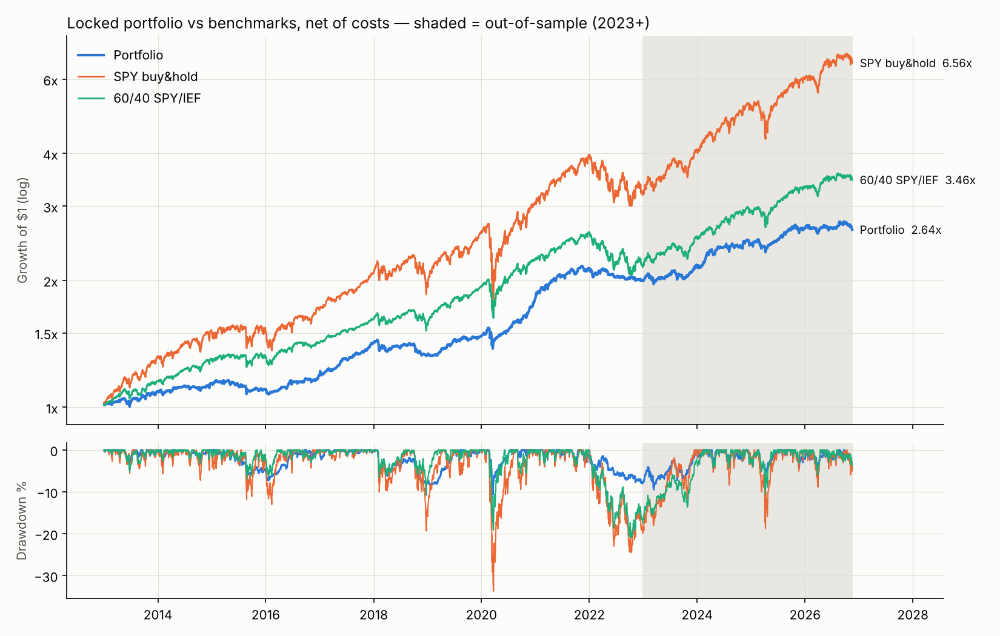
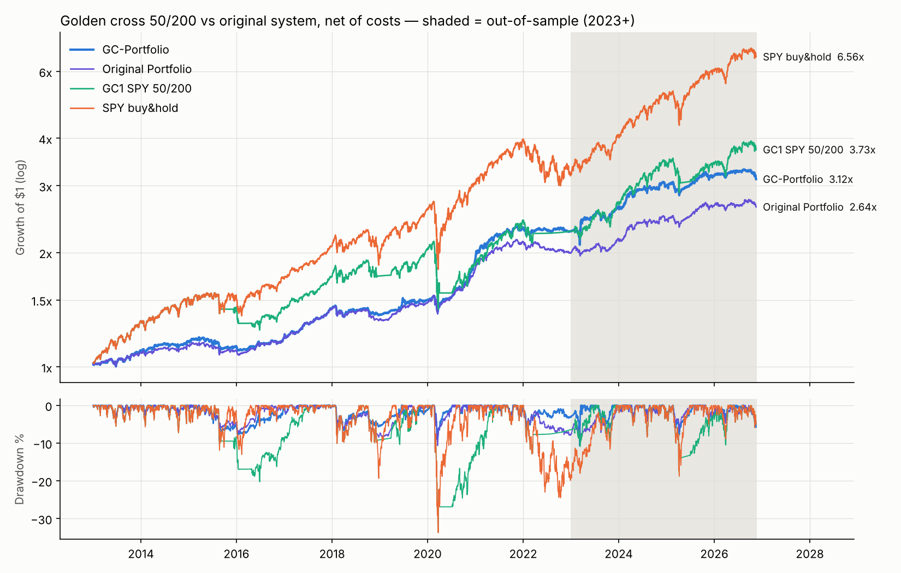
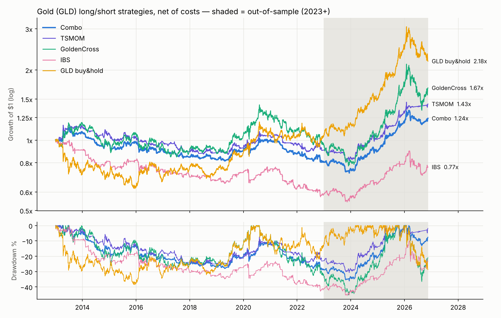

# Multi-sleeve systematic trading bot

Αυτόνομο σύστημα trading. Χρησιμοποιεί μόνο δωρεάν εργαλεία: Python, yfinance, vectorbt, quantstats και Alpaca paper.
Συνδυάζει τρεις στρατηγικές από δημοσιευμένη και πολλαπλά επαληθευμένη έρευνα. Οι παράμετροι κλειδώθηκαν πριν δούμε τα out-of-sample δεδομένα.



## Αποτελέσματα (καθαρά μετά από κόστη συναλλαγών)

| Περίοδος | CAGR | Vol | Sharpe (excess) | Sharpe (rf=0) | Max DD | SPY Sharpe | SPY Max DD |
|---|---|---|---|---|---|---|---|
| **In-sample 2013–2022** | 7.1% | 5.7% | **1.13** | 1.24 | −10.7% | 0.73 | −33.7% |
| **Out-of-sample 2023–16/11/2026** | 7.5% | 6.7% | **0.45** | 1.11 | −6.8% | 1.00 | −18.8% |
| Σύνολο 2013–2026 | 7.2% | 6.0% | 0.91 | 1.19 | −10.7% | 0.79 | −33.7% |

* Το **Sharpe (excess)** υπολογίζεται πάνω από την απόδοση των T-bills, με το ETF BIL ως proxy. Είναι ο σωστός ορισμός και αυτός που μετράμε για τον στόχο.
  Το Sharpe με rf=0 φαίνεται καλύτερο, κυρίως το 2023+ που τα T-bills απέδιδαν περίπου 3.8%, αλλά είναι παραπλανητικό.
* Το OOS **δεν πέτυχε τον στόχο Sharpe > 1**. Η απόδοση ήταν θετική και τα drawdowns χαμηλά, αλλά το σύστημα υστέρησε σημαντικά έναντι του SPY και του 60/40.
* Το 95% διάστημα εμπιστοσύνης (block bootstrap) για το OOS Sharpe είναι [−0.48, 1.47]. Τα 3.9 χρόνια δεν αρκούν για να ξεχωρίσουμε στατιστικά το 0.45 από το 1.13.

Αναλυτικοί πίνακες, αποδόσεις ανά έτος και συσχετίσεις βρίσκονται στο [`results/summary.md`](results/summary.md).
Τα πλήρη tearsheets είναι στα `results/tearsheet_oos.html` και `results/tearsheet_full.html`.

## Στρατηγικές (sleeves)

| Sleeve | Ιδέα | Πηγή | Εκτέλεση |
|---|---|---|---|
| **Trend** | 13 ETFs (μετοχές, ομόλογα, χρυσός, εμπορεύματα, USD). Long όταν η απόδοση 1/3/6/12 μηνών είναι θετική. Inverse-vol βάρη και vol target 10%. Μηνιαίο rebalance. | Moskowitz-Ooi-Pedersen 2012, Hurst et al. 2017, Faber 2007 | close t+1 |
| **MeanRev** | SPY/QQQ/IWM. Αγορά όταν IBS=(C−L)/(H−L) < 0.2 και τιμή > SMA200. Έξοδος όταν close > χθεσινό high ή μετά από 10 μέρες. | Connors & Alvarez 2009, Pagonidis 2014 | open t+1 |
| **Crypto** | BTC/ETH με το ίδιο trend σήμα, vol target 30%, εβδομαδιαίο rebalance | Liu & Tsyvinski 2021 | close t+1 |

Τα sleeves συνδυάζονται με **inverse-volatility** κατανομή (252 ημερών, μηνιαία), με στόχο vol χαρτοφυλακίου 10% και **χωρίς μόχλευση** (max 1.0x). Τα αχρησιμοποίητα μετρητά αποδίδουν το επιτόκιο των T-bills.

## Βέλτιστες πρακτικές που εφαρμόστηκαν

1. **Διαχωρισμός in-sample / out-of-sample.** Όλες οι αποφάσεις πάρθηκαν με δεδομένα ≤2022 και το config κλειδώθηκε (`trading_system/portfolio.py::CONFIG`).
2. **Τεστ για look-ahead bias.** Οι αποδόσεις 2013–2022 βγαίνουν ίδιες είτε τρέξουμε με δεδομένα μέχρι το 2022 είτε μέχρι σήμερα (diff = 0.0).
3. **Εκτέλεση με καθυστέρηση.** Σήμα στο close και εκτέλεση στο επόμενο close ή open, ποτέ στην ίδια τιμή που δημιούργησε το σήμα.
4. **Ρεαλιστικά κόστη.** 5 bps ανά συναλλαγή για ETFs και 15 bps για crypto, με κόστος δανεισμού T-bill +1%. Τα βάρη ολισθαίνουν (drift) ανάμεσα στα rebalances.
5. **Ανεξάρτητη επαλήθευση του engine** με το vectorbt: ίδιο CAGR, συσχέτιση ημερήσιων αποδόσεων 1.0000 (`research/crosscheck_vectorbt.py`).
6. **Robustness grid.** Το IBS sleeve είναι θετικό σε όλες τις παραλλαγές παραμέτρων και κόστους (`research/robustness_insample.py`). Χρησιμοποιήθηκαν οι «σχολικές» παράμετροι και όχι οι βέλτιστες του grid.
7. **Ειλικρινής μέτρηση δοκιμών.** Δοκιμάστηκαν περίπου 2 παραλλαγές του trend (εβδομαδιαίο ή μηνιαίο rebalance) και 2 επίπεδα μόχλευσης (1.0x ή 1.5x). Το grid του IBS χρησιμοποιήθηκε μόνο ως έλεγχος ευρωστίας.

## Τι μάθαμε από το OOS (2023+)

* **Το MeanRev κατέρρευσε** (Sharpe 0.03 έναντι 0.89 in-sample). Αυτό συμφωνεί με τη βιβλιογραφία για τη φθορά των βραχυπρόθεσμων ανωμαλιών μετά τη δημοσίευσή τους.
* **Το Trend έγινε «long equities»** σε μια έντονα ανοδική αγορά (συσχέτιση 0.74 με το SPY), οπότε χάθηκε η διαφοροποίηση.
* **Το Crypto** παρέμεινε θετικό (Sharpe 0.68), αλλά με drawdown −40%.
* Το υψηλό επιτόκιο των T-bills ανέβασε τον πήχη: μια στρατηγική με 7.5% CAGR είχε μόνο περίπου 3.7% υπερβάλλουσα απόδοση.

**Σημαντικό:** αν αλλάζαμε τώρα παραμέτρους για να «φτιάξουμε» το 2023+, θα κάναμε overfitting και το OOS θα έχανε κάθε αξία. Το επόμενο τίμιο τεστ είναι το **forward paper trading**.

## Πείραμα 2: Golden cross (SMA50 > SMA200)

Ίδια διαδικασία: οι παράμετροι 50/200 κλειδώθηκαν με δεδομένα ≤2022 και το OOS έτρεξε μία φορά.
Υπάρχει μία επιφύλαξη: το OOS το είχαμε ήδη δει από το πείραμα 1, άρα αυτή είναι η 2η δοκιμή στην ίδια περίοδο.
Κώδικας: `research/golden_cross_insample.py`, `research/golden_cross_oos.py`. Αποτελέσματα: [`results/golden_cross_summary.md`](results/golden_cross_summary.md).



| Sharpe (excess) | In-sample 2013–22 | OOS 2023–26 | Max DD OOS |
|---|---|---|---|
| GC1: SPY long/cash | 0.60 | 0.65 | −18.8% |
| GC2: 13 ETFs, inverse-vol | 0.51 | 0.10 | −6.7% |
| GC3: BTC/ETH, vol target 30% | 1.48 | 0.62 | −35.6% |
| **GC-Portfolio** (GC2 + MeanRev + GC3) | **1.26** | **0.47** | −9.5% |
| Αρχικό portfolio (TSMOM) | 1.14 | 0.45 | −6.8% |
| SPY buy&hold | 0.73 | 1.00 | −18.8% |

Συμπέρασμα: το golden cross **δεν περνά τον στόχο Sharpe > 1 στο OOS**. Στο SPY μειώνει τα βαθιά drawdowns, όπως το 2008 και το 2022.
Χάνει όμως τις γρήγορες ανακάμψεις, όπως το 2020 και τον Απρίλιο του 2025, όπου έβγαλε +0.7% έναντι +17.7% για το SPY. Γι' αυτό υστερεί του buy&hold.

## Πείραμα 3: Χρυσός (GLD), long και short

Ίδιες στρατηγικές σε εκδοχή buy/sell, ίδιες περίοδοι, κλειδωμένο config (`trading_system/gold.py::GOLD_CONFIG`).
Κόστη: 5 bps ανά συναλλαγή, κόστος δανεισμού short 0.5% τον χρόνο, χωρίς τόκο στα έσοδα του short.
Κώδικας: `research/gold_insample.py`, `research/gold_oos.py`. Αποτελέσματα: [`results/gold_summary.md`](results/gold_summary.md).



| Sharpe (excess) | 2006–12 (ανοδικός χρυσός) | **IS 2013–22** | **OOS 2023–26** | Max DD OOS |
|---|---|---|---|---|
| TSMOM L/S | 0.62 | −0.15 | 0.83 | −12.0% |
| Golden cross L/S | 0.41 | −0.00 | 0.60 | −36.6% |
| IBS L/S | −0.28 | −0.60 | 0.27 | −21.3% |
| Combo | 0.26 | **−0.32** | **0.76** | −13.1% |
| GLD buy&hold | 0.83 | 0.07 | 0.82 | −28.8% |

Συμπέρασμα: **κανένα σύστημα χρυσού δεν περνά το in-sample**, άρα με τους κανόνες μας κανένα δεν θα έπρεπε να πάει σε live.
* Τα κέρδη του 2023+ προήλθαν από το ότι οι στρατηγικές ήταν long στο 75–84% των ημερών ενός ιστορικού bull market. Δεν ξεπέρασαν όμως το Sharpe του buy&hold.
* Η short πλευρά δεν πρόσθεσε αξία σε καμία περίοδο.
* Το IBS (mean reversion) δεν λειτουργεί στον χρυσό: είναι αρνητικό σε όλο το grid παραμέτρων.
* Το μόνο θετικό στοιχείο είναι ότι το TSMOM είχε σταθερά μικρότερα drawdowns από το buy&hold (−12% έναντι −29% στο OOS).

## Χρήση

```bash
pip install -r requirements.txt
python run_backtest.py --refresh       # κατεβάζει δεδομένα, τρέχει IS/OOS, γράφει results/
python live_trader.py --capital 10000  # σημερινά target βάρη + εντολές (dry run)

# Paper trading (δωρεάν): κλειδιά Paper από app.alpaca.markets
export ALPACA_API_KEY=...  ALPACA_SECRET_KEY=...
python live_trader.py --alpaca         # κάθε μέρα μετά το κλείσιμο των ΗΠΑ (~23:15 ώρα Ελλάδας)
```

Ασφάλειες: χρησιμοποιείται μόνο το paper endpoint, υπάρχει όριο μεγέθους εντολής (35% του equity), και ένα αρχείο `KILL` σταματά κάθε συναλλαγή.
**Το κομμάτι της Alpaca δεν έχει δοκιμαστεί ακόμα σε πραγματικό λογαριασμό.**

Για αυτόματη καθημερινή εκτέλεση (cron, Linux/Mac):
`15 23 * * 1-5 cd /path/trading-bot && python live_trader.py --alpaca >> live.log 2>&1`

## Δομή

```
trading_system/  data.py (yfinance+cache) · strategies.py · engine.py · portfolio.py (LOCKED CONFIG) · metrics.py
research/        in-sample έρευνα, robustness, cross-check με vectorbt
results/         summary.md, equity.png, daily_returns.csv, quantstats tearsheets
```

*Δεν αποτελεί επενδυτική συμβουλή. Οι αποδόσεις του backtest δεν εγγυώνται μελλοντικές αποδόσεις.*
